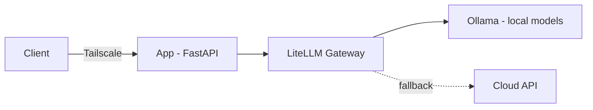

# Enterprise AI Project Template

> A hardened MLOps boilerplate for deploying secure, locally-hosted AI architectures — fast.


## Why this exists

Most AI projects start with bad defaults: secrets in the repo, containers running as
root, and a hard dependency on a cloud API. This template flips all three.

**Local-first. Containerized. Secret-scanned. Private by default.**

Clone it and you have a production-shaped starting point instead of a blank folder.

## Architecture



- **App** — FastAPI service exposing `/health` and `/chat`
- **Gateway** — LiteLLM; one OpenAI-compatible endpoint with routing + fallback
- **Runtime** — Ollama for local inference

## Security model

| Concern | Default |
| --- | --- |
| Network exposure | None public — reached over Tailscale |
| Secrets | `.env` gitignored; gitleaks in pre-commit + CI |
| Containers | Non-root user, pinned images |
| Dependencies | Dependabot tracks updates |
| App port | Bound to `127.0.0.1` only |

## Project structure

```
├── src/            application code
├── tests/          unit + integration tests
├── config/         non-secret config + prompts
├── docs/           architecture + ADRs
├── scripts/        bootstrap, healthcheck
├── data/           raw / processed (gitignored)
└── .github/        CI, security, templates
```

## Quick start

```bash
git clone git@gh-public:kirk-keel/ai-project-template.git
cd ai-project-template
cp .env.example .env
make setup
make up
```

Verify:

```bash
curl http://localhost:8000/health
```

## Configuration

Secrets and environment live in `.env` (see `.env.example`). Non-secret app config
lives in `config/`.

## Development

```bash
make lint      # ruff + black --check
make fmt       # auto-format
make test      # pytest
make security  # gitleaks scan
```

## Roadmap

- [ ] Integration tests against the gateway
- [ ] Structured logging + request tracing
- [ ] Observability (token/cost metrics)
- [ ] GPU inference profile

## Contributing

See [CONTRIBUTING.md](CONTRIBUTING.md).

## License

MIT — see [LICENSE](LICENSE).
